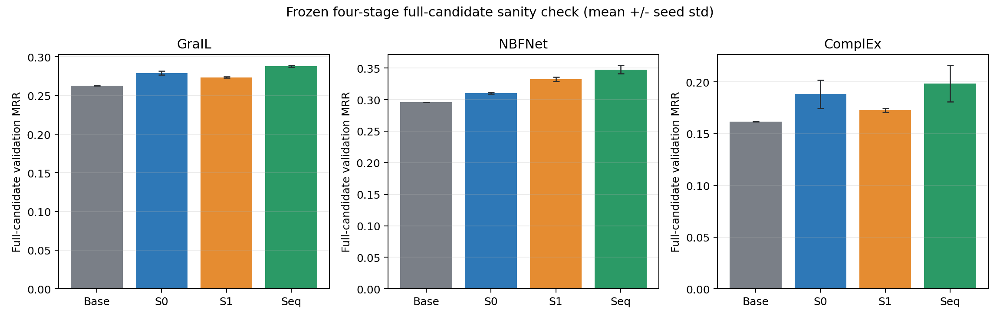

# Sequential RIVE-Ladder

[](https://github.com/forgooder/RIVE_Sequential/actions/workflows/ci.yml)
[](https://www.python.org/)
[](https://pytorch.org/)
[](#evaluation-boundary)

Official implementation and validation artifact for **Sequential RIVE-Ladder**,
a lightweight score-correction module for knowledge graph ranking. The method
keeps a pretrained backbone frozen and adds two bounded evidence stages:

1. compact endpoint-role evidence (`7R+4` features); and
2. neighbor-resolved one-hop relation-shell evidence (`12R+10` features).

The repository is intentionally backbone-agnostic. A backbone only needs to
export deterministic candidate scores in a frozen order. No entity-ID
embedding is introduced by the adapter.

> **Status.** This public release contains the method, source-only trainer,
> contract tests, full-candidate validation analyzer, synthetic end-to-end
> smoke data, aggregate validation summaries, and an aggregate entity-inductive
> sampled-test snapshot. It contains no private datasets, third-party
> checkpoints, raw predictions, or per-candidate test scores.

## Method

For candidate `c` in query group `q`, let `s_b(q,c)` be the frozen backbone
score. Sequential RIVE-Ladder computes

```text
s_norm(q,c) = source_bounded_query_normalize(s_b(q,c))
s_0(q,c)    = s_norm(q,c) + 0.5 * tanh(g_0(x_endpoint(q,c)))
s_final     = s_0(q,c) + B_1 * tanh(g_1(x_shell(q,c), r_q))
B_1         = 0.5 * sigmoid(alpha)
```

Both output heads are zero-initialized. The initial adapter therefore produces
exactly the normalized backbone scores, while the positive per-query
normalization preserves the original candidate order. Stage 0 is trained and
then frozen before Stage 1 is fitted. The backbone stays frozen throughout.

```text
frozen backbone scores
          |
source-frozen query normalization
          |
          +---- bounded endpoint-role correction (Stage 0)
          |
          +---- bounded one-hop shell correction (Stage 1)
          |
     corrected ranking scores
```

The training objective is query-group listwise cross entropy. Model selection
uses source validation only. See [Method](docs/METHOD.md) for the feature
definition, tensor shapes, optimization sequence, and backbone interface.

## Validation snapshot

The included snapshot evaluates a fixed validation subset with full
target-entity filtered ranking, conservative ties, both prediction directions,
three frozen adapter seeds, and fact-cluster paired bootstrap.

| Backbone | Track | Base MRR | Stage 0 | Stage 1-only | Sequential | Delta vs Base |
|---|---|---:|---:|---:|---:|---:|
| GraIL | entity-inductive | 0.262499 | 0.279080 | 0.273467 | **0.287780** | **+0.025282** |
| NBFNet | entity-inductive | 0.295588 | 0.310398 | 0.332224 | **0.347648** | **+0.052060** |
| ComplEx | transductive diagnostic | 0.161631 | 0.188285 | 0.172706 | **0.198284** | **+0.036653** |



These numbers are a **fixed-subset validation sanity check**, not a full
benchmark and not a locked-test result. GraIL and NBFNet are entity-inductive;
ComplEx is only a transductive interface diagnostic. Detailed per-seed metrics,
confidence intervals, parameter counts, plots, and hashes are under
[`results/www_validation_snapshot/`](results/www_validation_snapshot/).

## Entity-inductive test snapshot

The public test snapshot evaluates official target test facts in both prediction
directions with `1 positive + 50 unique strict-filtered negatives`, conservative
ties, candidate seed `20261024`, and a source-selected adapter seed of `43`.
Target test labels are never used for training, tuning, checkpoint selection, or
early stopping.

Of 72 expected backbone-dataset cells, 61 have executed test artifacts and 11
remain explicitly missing because the required checkpoint or verifiable pairing
is unavailable. Among the 57 strictly entity-disjoint completed cells, 44 have a
positive 95% paired-bootstrap confidence interval and 13 are statistically
uncertain; none is significantly negative. Four additional WN18RR-v3 cells are
reported only as exploratory because that local split contains eight
source-target entity overlaps.

These are sampled filtered test results, not full-candidate results, and are not
directly comparable to the validation table above. See the frozen protocol,
complete 72-cell matrix, missing-cell reasons, aggregate metrics, and hashes in
[`results/entity_inductive_test_snapshot/`](results/entity_inductive_test_snapshot/).

## Installation

```bash
git clone https://github.com/forgooder/RIVE_Sequential.git
cd RIVE_Sequential
python -m venv .venv
source .venv/bin/activate
python -m pip install --upgrade pip
python -m pip install -e '.[test]'
```

The release is tested with Python 3.10.20, PyTorch 2.1.2, NumPy 1.26.4,
CUDA 12.1, and pytest 9.1.1. The declared package bounds also support newer
compatible versions.

## Quick verification

Run all public contract checks and validate the included result hashes:

```bash
bash scripts/verify_release.sh
```

Expected outcome:

```text
epoch-zero identity and rank preservation: PASS
10 passed
release verification: PASS
```

## End-to-end smoke run

Generate deterministic synthetic caches matching the public cache contract,
then train both stages:

```bash
python examples/make_synthetic_cache.py --output data/synthetic_smoke
python scripts/train_adapter.py --config configs/synthetic_smoke.json
```

This checks cache hashing, candidate alignment, one-positive-per-query,
source-only normalization, epoch-zero identity, sequential training,
append-only output, checkpoint hashing, and paired bootstrap. It is a software
contract test and does not support a scientific performance claim.

For real cached backbone scores, edit
[`configs/example_adapter.json`](configs/example_adapter.json) and follow the
[`cache contract`](docs/CACHE_CONTRACT.md).

## Full-candidate analysis

The release includes a backbone-independent evaluator for full-target-entity
filtered ranking:

```bash
python scripts/analyze_fullrank_scores.py \
  --scores /path/to/fullrank_scores.npz \
  --output /new/append-only/output \
  --bootstrap-samples 10000 \
  --bootstrap-seed 20261021
```

The score schema, filtering policy, tie rule, provenance sidecar, and fact-level
bootstrap are documented in
[`FULL_CANDIDATE_EVALUATION.md`](docs/FULL_CANDIDATE_EVALUATION.md).

## Repository layout

```text
configs/                     frozen example and smoke configurations
docs/                        method, cache, evaluation, reproducibility
examples/                    minimal forward pass and synthetic cache generator
results/www_validation_snapshot/
                             aggregate validation tables, plots, hashes
results/entity_inductive_test_snapshot/
                             sampled TEST_IND aggregates, coverage, hashes
scripts/train_adapter.py     source-only two-stage trainer
scripts/analyze_fullrank_scores.py
                             append-only full-candidate analyzer
src/rive_ladder_final/       PyTorch model and shared ranking contracts
tests/                       architecture and evaluator contract tests
```

## Evaluation boundary

The sampled-test protocol is candidate-clean ranking with one positive and 50
unique strict-filtered negatives, conservative ties, both prediction directions,
and source-only checkpoint selection. Full-candidate evaluation is a separate
fixed-subset validation track. The two tracks are reported separately.

The following are explicitly out of scope for this release:

- model selection, tuning, or training using target test labels;
- claims that the transductive ComplEx diagnostic is unseen-entity inference;
- comparison of `AUC-PR` values produced under different class balances;
- redistribution of third-party datasets, checkpoints, or model code;
- reproduction of paper numbers without the corresponding external backbone
  checkpoints and hashed score/feature caches.

See [Reproducibility](docs/REPRODUCIBILITY.md) for the exact evidence levels and
artifact checklist.

## Citation

The manuscript citation will be added after publication. Until then, cite the
software release using [`CITATION.cff`](CITATION.cff):

```bibtex
@software{rive_sequential_2026,
  title  = {Sequential RIVE-Ladder},
  author = {forgooder},
  year   = {2026},
  url    = {https://github.com/forgooder/RIVE_Sequential}
}
```

## License

No open-source license has been selected yet. Copyright remains with the
authors. Add a license before inviting third-party redistribution or reuse.
